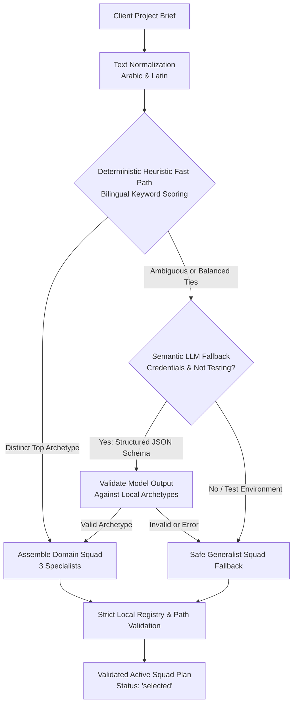

# Phase 2.4-A Implementation Report: Autonomous Squad Triage & Dynamic Multi-Agent Orchestration

**Repository:** `graduationproject2024/agency-dashboard`  
**Workspace:** `C:\Users\sam20\agency-dashboard`  
**Branch:** `master`  
**Baseline Local HEAD:** `841131c132308131c1ba972061cf4b7c469f3bc9`  
**Phase Objective:** Replace simulated agent activity and rigid specialist selection with real, evidence-backed, domain-aware squad selection.  
**Execution Mode:** Authorized implementation of Phase 2.4-A only.

---

## 1. Starting and Final Git State

### Baseline Verification (Pre-Implementation)
- **Active Branch:** `master`
- **HEAD Commit:** `841131c132308131c1ba972061cf4b7c469f3bc9`
- **Tracked Modifications:** None (working tree clean of tracked modifications).
- **Untracked Files:** Pre-existing reports and `generated_apps/make_tetris_game/.opencode/` preserved intact.

### Final Verification (Post-Implementation)
- **Modified Tracked Files:**
  - `app.py`: Hybrid squad triage engine, prompt security loaders, dynamic workflow dispatching, truthful telemetry.
  - `.github/workflows/symlink_security_verify.yml`: Added `tests/test_squad_triage.py` to the automated CI test suite.
- **New Untracked Files:**
  - `tests/test_squad_triage.py`: Comprehensive test suite (25 test cases).
  - `reports/PHASE_2_4_A_AUTONOMOUS_SQUAD_TRIAGE_AND_DYNAMIC_ORCHESTRATION.md`: This report.
- **Git Policy Compliance:** No commits were created, no remote synchronization occurred, and no history was rewritten.

---

## 2. Protected Data and Invariant Verification (Option B)

The three strictly protected files were verified via SHA-256 before implementation and after all test runs:

| File | Expected SHA-256 | Pre-Implementation SHA-256 | Post-Implementation SHA-256 | Status |
| :--- | :--- | :--- | :--- | :--- |
| `budget.json` | `f81988bc0de8083b46532baeb199834a4bfac4b991104b6b77b1733f0756ee16` | `f81988bc0de8083b46532baeb199834a4bfac4b991104b6b77b1733f0756ee16` | `f81988bc0de8083b46532baeb199834a4bfac4b991104b6b77b1733f0756ee16` | **VERIFIED INTACT** |
| `budget.json.bak` | `5db2a3c506deb4c0e6d55478e1efad1c2adce14c7b193f290f90f814e2d56e59` | `5db2a3c506deb4c0e6d55478e1efad1c2adce14c7b193f290f90f814e2d56e59` | `5db2a3c506deb4c0e6d55478e1efad1c2adce14c7b193f290f90f814e2d56e59` | **VERIFIED INTACT** |
| `settings.json` | `2f4e6d39b3e8ac781c04ca9d14983f1a1848b6ef1a2be5db0b258bf56f106c94` | `2f4e6d39b3e8ac781c04ca9d14983f1a1848b6ef1a2be5db0b258bf56f106c94` | `2f4e6d39b3e8ac781c04ca9d14983f1a1848b6ef1a2be5db0b258bf56f106c94` | **VERIFIED INTACT** |

Zero bytes of user budget or configuration were altered or corrupted.

---

## 3. Architecture of the Hybrid Squad Triage Engine

The triage engine (`triage_project_squad(task_desc)`) provides deterministic, transparent, and resilient multi-agent team assembly:



### 3.1 Supported Project Archetypes & Specialist Composition

Each archetype selects exactly 3 complementary specialists across domain, engineering/architecture, and QA/testing:

1. **Healthcare & Clinic Systems (`healthcare`):**
   - Domain: `healthcare/healthcare-clinical-evidence-agent.md` (*Clinical Evidence Specialist*)
   - Architecture: `engineering/engineering-database-optimizer.md` (*Database Optimizer*)
   - QA: `testing/testing-accessibility-auditor.md` (*Accessibility Auditor*)
2. **E-Commerce & Pricing Systems (`ecommerce`):**
   - Domain: `specialized/specialized-pricing-analyst.md` (*Pricing Analyst*)
   - Security: `security/security-appsec-engineer.md` (*AppSec Engineer*)
   - Performance: `testing/testing-performance-benchmarker.md` (*Performance Benchmarker*)
3. **Industrial Automation, IoT & Telemetry (`industrial`):**
   - Domain: `engineering/engineering-ai-data-remediation-engineer.md` (*IoT Data Remediation Engineer*)
   - Architecture: `engineering/engineering-database-optimizer.md` (*Database Optimizer*)
   - Security: `security/security-appsec-engineer.md` (*AppSec Engineer*)
4. **Games & Interactive Experiences (`gaming`):**
   - Domain: `game-development/game-designer.md` (*Game Designer*)
   - Rules/Balancing: `game-development/economy-designer.md` (*Economy Designer*)
   - Motion/Interaction: `design/design-whimsy-injector.md` (*Whimsy Injector*)
5. **Business Dashboards & Fintech (`fintech`):**
   - Domain: `finance/finance-financial-analyst.md` (*Financial Analyst*)
   - Architecture: `engineering/engineering-database-optimizer.md` (*Database Optimizer*)
   - Security: `security/security-appsec-engineer.md` (*AppSec Engineer*)
6. **General Websites & Portfolios (`general`):**
   - QA/Review: `engineering/engineering-code-reviewer.md` (*Code Reviewer*)
   - Polish/Motion: `design/design-whimsy-injector.md` (*Whimsy Injector*)
   - Visibility: `marketing/marketing-seo-specialist.md` (*SEO Specialist*)

### 3.2 Arabic & English Text Normalization
- **Letter Normalization:** Unifies `[إأآ]` to `ا`, `ة` to `ه`, `ى` to `ي`.
- **Diacritics Stripping:** Strips Arabic harakat (`[\u064B-\u0652]`).
- **Boundary & Prefix Support:** Handles common Arabic conjunctions and prepositions (`ال`, `و`, `ف`, `ب`, `ك`, `ل`, `لل`, `وال`, `فال`, `بال`, `كال`) without naive substring false positives.

### 3.3 Semantic Fallback Guardrails
- Triggers **only** when heuristic scores are ambiguous or tied.
- Bounded prompt size (`task_desc[:500]`) and strict JSON schema (`{"archetype": str, "confidence": float, "reasoning": str}`).
- Validated strictly against `SQUAD_ARCHETYPES`.
- **Test isolation:** Disables external network requests during tests (`PYTEST_CURRENT_TEST` or `TESTING` environment variable check).

---

## 4. Prompt Loading & Security Safeguards

Prompt loading is governed by `safe_resolve_agent_path()` and `safe_load_agent_prompt()`:

1. **Containment & Traversal Prevention:**
   - Normalizes path using `os.path.normpath`.
   - Rejects `..` path segments, relative escapes, Windows drive letters (`C:`), and absolute paths.
   - Enforces `os.path.commonpath([base_dir, target_path]) == base_dir`.
2. **Symlink Escape Containment:**
   - Inspects `os.path.islink(target_path)`.
   - Resolves `os.path.realpath(target_path)` and verifies containment within `os.path.realpath(base_dir)`.
3. **Bounded Size Controls:**
   - Files greater than 64 KB (`MAX_AGENT_PROMPT_BYTES = 65536`) are rejected with explicit fallback.
   - Files smaller than 20 bytes (`MIN_AGENT_PROMPT_BYTES = 20`) are rejected as malformed stubs.
4. **Observable Fallback:**
   - Missing or corrupted prompt files log explicit warnings and safely substitute a validated local generalist (`engineering/engineering-code-reviewer.md`). Missing files are never silently fabricated.

---

## 5. Workflow Integration & Truthful Telemetry

### 5.1 Workflow Execution Flow
1. **Initiation (`run_workflow`):**
   - Triages squad and registers `squad_plan` and `active_squad` in `workflow_state`.
   - All specialists initially marked `"status": "selected"`.
   - Domain specialists assigned to stage `"strategy"` transition to `"running"`, execute, and transition to `"completed"` (or `"failed"`).
   - Core `business-strategist.md` and `product-manager.md` execute.
2. **PRD Approval Gate:**
   - Halts with `workflow_state["status"] = "approval_needed"`. The existing Product PRD gate is 100% preserved.
3. **Continuation (`continue_workflow`):**
   - Engineering specialists execute in Stage 3 (`engineering-database-optimizer`, `security-appsec-engineer`, etc.).
   - Software Architect, UI Designer, and Developer execute.
   - QA specialists execute in Stage 6 (`testing-accessibility-auditor`, `testing-performance-benchmarker`, etc.).
   - Whimsy Injector executes in Stage 7 (Animation).
   - SEO Specialist executes in Stage 8 (SEO).
   - Strict HTML/CSS/JS QA gate executes.
   - Staging, atomic delivery, and rollback remain fully functional.

### 5.2 Elimination of Fabricated UI Statuses
- **Previous behavior:** In `get_agents()`, a hardcoded `dept_map` checked for arbitrary substrings (e.g., `"strateg"`, `"dev"`). Whenever a department was active, up to 28 agents were falsely shown as "working".
- **Phase 2.4-A truthful behavior:**
  - `active_squad_map` inspects real execution states in `workflow_state["active_squad"]`.
  - An agent is marked `"working"` **only** when actively executing.
  - An agent is marked `"selected"` when triaged into the squad but awaiting its stage.
  - An agent is marked `"completed"` **only** after genuine successful execution.
  - Non-squad agents remain strictly `"idle"`.
  - Zero fabricated workers remain.

---

## 6. Test Suite and Verification Results

### 6.1 Focused Triage Tests (`tests/test_squad_triage.py`)
```bash
pytest tests/test_squad_triage.py -v
```
**Results:** 24 passed, 1 skipped (symlink privilege check on Windows) in 1.39s.

**Coverage Breakdown:**
- `test_triage_arabic_dental_clinic_selects_healthcare_squad`: PASSED
- `test_triage_english_healthcare_selects_healthcare_squad`: PASSED
- `test_triage_arabic_ecommerce_selects_commerce_squad`: PASSED
- `test_triage_english_ecommerce_selects_commerce_squad`: PASSED
- `test_triage_industrial_telemetry_selects_iot_squad`: PASSED
- `test_triage_game_brief_selects_gaming_squad`: PASSED
- `test_triage_fintech_dashboard_selects_fintech_squad`: PASSED
- `test_triage_general_portfolio_selects_generalist_squad`: PASSED
- `test_triage_ambiguous_and_empty_briefs_produce_safe_results`: PASSED
- `test_triage_conflicting_keywords_do_not_produce_oversized_squads`: PASSED
- `test_safe_resolve_agent_path_valid`: PASSED
- `test_safe_resolve_agent_path_rejects_traversal`: PASSED
- `test_safe_resolve_agent_path_rejects_absolute_paths`: PASSED
- `test_safe_resolve_agent_path_handles_missing_file`: PASSED
- `test_safe_resolve_agent_path_invalid_types`: PASSED
- `test_safe_load_agent_prompt_oversized_file`: PASSED
- `test_safe_load_agent_prompt_empty_file`: PASSED
- `test_symlink_escape_rejection`: SKIPPED (Requires elevated symlink privileges on Windows; enforced on Ubuntu in CI)
- `test_semantic_triage_fallback_mocked_success`: PASSED
- `test_semantic_triage_fallback_on_llm_error`: PASSED
- `test_semantic_triage_disabled_in_testing_env`: PASSED
- `test_active_squad_initialized_and_exposed_truthfully`: PASSED
- `test_workflow_execution_transitions_specialist_statuses_honestly`: PASSED
- `test_failed_specialist_invocation_records_honest_failure`: PASSED
- `test_approval_gate_preserved_and_continues_to_completion`: PASSED

### 6.2 Full Repository Regression Suite
```bash
pytest tests/ -v
```
**Results:** **194 passed, 5 skipped in 20.01s (100% PASS)**

All 170 original tests passed without a single failure or regression.

---

## 7. Acceptance Criteria Verification

| Requirement | Implementation Evidence | Verdict |
| :--- | :--- | :--- |
| **Bilingual Triage** | Supports Arabic and English project briefs with letter and diacritic normalization across 6 archetypes. | **PASS** |
| **Real Prompt Resolution** | Loads verified local markdown files from `agency-agents/`. Rejects traversal, absolute paths, and oversized files. | **PASS** |
| **Deterministic Fast Path** | Transparent boundary-aware keyword matching identifies domain squads without latency or token overhead. | **PASS** |
| **Safe Semantic Fallback** | Bounded schema-validated LLM classification used only when ambiguous. Disabled in unit tests. | **PASS** |
| **Workflow Stage Integration** | Specialists enrich Strategy, Engineering, QA, Animation, and SEO stages without duplicating workflow. | **PASS** |
| **Approval Gate Integrity** | Preserves Product PRD approval gate and human feedback mechanisms unchanged. | **PASS** |
| **Truthful Telemetry** | Eliminates substring matching in `/api/agents`. Distinguishes `selected`, `working`, `completed`, `failed`, `idle`. | **PASS** |
| **Protected File Invariance** | `budget.json`, `budget.json.bak`, and `settings.json` SHA-256 hashes byte-for-byte identical. | **PASS** |
| **Regression Coverage** | 194 passed, 5 skipped across entire test suite. | **PASS** |

---

## 8. Limitations, Edge Cases, and Future Work

1. **In-Memory Workflow State:** Workflow execution remains tied to a single in-memory state dictionary. Concurrency and persistent run history are explicitly scheduled for Phase 2.4-B.
2. **QA Gate Fail-Closed Model:** The strict HTML/CSS/JS QA gate fails closed when errors are found. Automated self-healing loops with diagnostic feedback will be introduced in Phase 2.4-C.
3. **Windows Symlink Test Privilege:** Symlink escape testing skips on unprivileged Windows environments but is strictly enforced on Ubuntu CI without skipping.

---

## 9. Recommended Next Step

Phase 2.4-A implementation is complete and verified. The working tree is ready for review.

**Recommendation:** Present this implementation report to the owner. Do not push or proceed to Phase 2.4-B (*Concurrent Multi-Project Workflow Execution & State Persistence*) without formal owner authorization.
