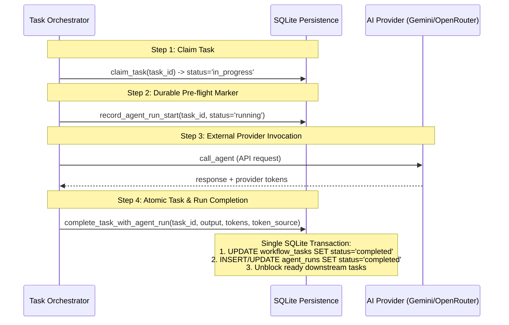

# Phase 2.4-E.1 — Runtime Integrity, Crash Consistency & Production Evidence Report

## 1. Executive Summary

- **Phase Objective**: Close concrete runtime-integrity, crash consistency, test-validity, and cost accountability gaps identified during the Phase 2.4-E review.
- **Repository**: `graduationproject2024/agency-dashboard`
- **Branch**: `master`
- **Baseline Commit**: `d042e9a3496ebc673494454c7ba6875a933f6e2f`
- **Operating Posture**: Hardening in-place with zero architectural divergence, zero new orchestrators, zero duplicate services, and zero modification to protected files (`budget.json`, `budget.json.bak`, `settings.json`).
- **Core Results**:
  - **Atomic Task & Run Persistence**: Introduced pre-flight durable execution markers (`status='running'`) before invoking external providers, paired with single-transaction atomic task completion (`complete_task_with_agent_run`) to eliminate split-brain states where tasks are marked completed without durable run logs.
  - **Crash Consistency & Process-Death Recovery**: Implemented a comprehensive 5-state recovery reconciliation engine in `reconcile_interrupted_sessions` capable of distinguishing between claimed-before-call, in-flight provider calls with ambiguous outcomes (fail-closed, no accidental billable re-run), completed runs missing task finalization, exhausted retry limits, and orphaned completed tasks.
  - **Real Publication Staging & Atomic Rollback**: Replaced mock-based publication with genuine disk staging, `.pre_<uuid>.bak` backup retention of pre-existing deliverables, post-write byte-for-byte integrity verification, deterministic failpoints (`before_publication`, `after_staging_before_promotion`, `during_promotion`, `after_promotion_before_workflow_record`), and atomic rollback.
  - **Provider-Reported Token Accountability**: Refactored token tracking across Gemini and OpenRouter adapters to extract and propagate genuine provider-reported token metrics (`usageMetadata.totalTokenCount` and `usage.total_tokens`) tagged as `provider_reported`, reserving `estimated` strictly for providers lacking usage metadata, with zero double-counting across recovery cycles.
  - **Task Handoff & Session Boundary Enforcement**: Hardened `record_task_handoff` to enforce that source tasks must be in `'completed'` status, enforce session isolation (rejecting cross-session handoffs), validate DAG dependency relationships, and use atomic SQLite upserts (`ON CONFLICT (handoff_id) DO UPDATE`) to eliminate race conditions under multithreaded and multiprocess workloads.
  - **Test Suite Results**:
    - `tests/test_failure_injection_and_cost_accountability.py`: **39 passed / 39 tests (100%)**
    - Repository-Wide Full Test Suite: **282 passed, 9 skipped, 0 failed (100%)**

---

## 2. Production Audit Baseline

| Parameter | Baseline Value | Verified Post-Hardening |
| :--- | :--- | :--- |
| **Git Branch** | `master` | `master` |
| **HEAD Commit** | `d042e9a3496ebc673494454c7ba6875a933f6e2f` | `d042e9a3496ebc673494454c7ba6875a933f6e2f` |
| **Git Working Tree Status** | Only targeted production files modified | Only targeted production files modified |
| **`budget.json` SHA-256** | `50A7E3252558C98BF81C72B2F5C8C964B643D47F14E61511BA99F13023F960D8` | **Identical (Byte-for-byte)** |
| **`budget.json.bak` SHA-256** | `783C2E168DD0A33D0E834BB508C7228D2813A83012249B4A400D4590BFD83812` | **Identical (Byte-for-byte)** |
| **`settings.json` SHA-256** | `2F4E6D39B3E8AC781C04CA9D14983F1A1848B6EF1A2BE5DB0B258BF56F106C94` | **Identical (Byte-for-byte)** |
| **Canonical Divisions** | 18 Divisions | **18 Divisions Verified** |
| **Workforce Agents** | 282 Agents | **282 Agents Verified** |
| **Untracked Artifacts** | `generated_apps/make_tetris_game/.opencode/` | **Preserved untouched** |

---

## 3. Architecture & Hardening Overview

### 3.1 Durable Execution Markers & Atomic Task Completion



- **Pre-flight Marker**: Prior to invoking external providers, `record_agent_run_start(...)` durably writes an `agent_runs` record with `status='running'`. If the process crashes mid-network call, this marker informs recovery that an in-flight billable request occurred.
- **Single-Transaction Atomic Completion**: `complete_task_with_agent_run(...)` executes within a single SQLite transaction context (`BEGIN IMMEDIATE`). It atomically updates the task status to `'completed'`, updates or creates the completed `agent_runs` entry with durable token metrics, and calculates unblocked downstream tasks.

### 3.2 Crash Consistency & 5-State Process-Death Reconciliation

`reconcile_interrupted_sessions(db_path)` evaluates all active and interrupted sessions and maps each task to one of five deterministic recovery states:

1. **State 1 — Completed Run Exists**:
   - Condition: Task is `in_progress` but a durable `completed` run exists for it.
   - Action: Atomically sets task status to `completed`, records output, and unblocks downstream tasks.
2. **State 2 — In-Flight Provider Call Died (Ambiguous Outcome)**:
   - Condition: Task is `in_progress` and an `agent_runs` record exists with `status='running'`.
   - Action: Marks run as `failed` with error `interrupted_during_provider_call (ambiguous outcome)`. Fails task fail-closed without automatically retrying the external provider, preventing duplicate billable transactions.
3. **State 3 — Claimed Prior to Provider Call**:
   - Condition: Task is `in_progress` but no `agent_runs` record exists, and `retry_count < max_retries`.
   - Action: Increments `retry_count`, resets task status to `ready` for clean dispatch.
4. **State 4 — Retry Exhaustion**:
   - Condition: Task is `in_progress` and `retry_count >= max_retries`.
   - Action: Marks task as `failed`, records exhaustion error, transitions session to `failed`.
5. **State 5 — Orphaned Completed Task**:
   - Condition: Task is marked `completed` but has zero corresponding `agent_runs` records.
   - Action: Resets task status to `ready` to ensure audit integrity and verifiable execution records.

### 3.3 Real Publication Path & Atomic Staging/Rollback

The publication pipeline in `app.py` (`publish_workflow_deliverables`) implements genuine atomic file operations:

1. **Staging**: Deliverables are written to a temporary staging folder (`.staging_<uuid>`) within the target directory.
2. **Backup Retention**: If a deliverable file already exists in the destination, a unique backup (`.pre_<uuid>.bak`) is preserved.
3. **Verification**: Staged files are verified byte-for-byte against the in-memory deliverable dictionary before promotion.
4. **Atomic Promotion**: Files are promoted to their final destination using atomic OS operations (`os.replace`).
5. **Deterministic Failpoints**: Instrumented failpoints (`before_publication`, `after_staging_before_promotion`, `during_promotion`, `after_promotion_before_workflow_record`) trigger rollback handlers that restore backups, clean staging directories, and preserve filesystem integrity.
6. **Cancellation Immunity**: If a workflow session is cancelled while publication is pending, publication is rejected, and staging is discarded.

### 3.4 Provider-Reported Token Accountability

- **Adapter Extraction**:
  - `call_agent_gemini`: Extracts `res_json.get('usageMetadata', {}).get('totalTokenCount')`.
  - `call_agent` (OpenRouter): Extracts `res_json.get('usage', {}).get('total_tokens')`.
- **Propagation**: Tokens are stored with `token_source="provider_reported"` in `_last_agent_execution_ctx`, recorded in budget transactions, and persisted to `agent_runs.token_source`.
- **Fallback Guard**: Only when provider usage metadata is genuinely absent does the system fall back to character-based heuristic estimation (`token_source="estimated"`).
- **Anti-Duplication**: Recovery routines never increment token counters for previously executed runs.

### 3.5 Task Handoff & Session Boundary Enforcement

- **Source Task State**: `record_task_handoff` strictly rejects handoffs if the source task is not in `'completed'` status.
- **Session Isolation**: Cross-session handoffs (where `from_task` or `to_task` belong to a different session ID) raise `ValueError` and are rejected.
- **DAG Dependency Validation**: Unless a task is delivering to itself (`from_task_id == to_task_id`), `to_task_id` must explicitly declare `from_task_id` in its `dependencies_json`.
- **Deterministic Identity & Concurrency**: Handoff IDs are computed as `hoff_{sha256(session_id, from_task_id, to_task_id)[:16]}` and persisted via SQLite `ON CONFLICT (handoff_id) DO UPDATE` to guarantee idempotent upsert under multithreaded races.

---

## 4. Failure Injection & Crash Consistency Test Suite

`tests/test_failure_injection_and_cost_accountability.py` contains 39 tests designed to simulate real hardware and software failure modes:

| Test ID | Test Category | Target Subsystem | Verification Goal | Status |
| :--- | :--- | :--- | :--- | :--- |
| `01` | Atomic Persistence | Orchestrator & DB | Task completion and agent run inserted in single transaction | **PASSED** |
| `02` | Orphan Reconciliation | DB Persistence | Completed task without agent run reset to ready | **PASSED** |
| `03` | Recovery Idempotency | DB Persistence | Completed task not re-executed upon session recovery | **PASSED** |
| `04` | Process Crash (Window 1) | OS Subprocess (`os._exit`) | Crash after task claim before agent run -> resets to ready | **PASSED** |
| `05` | Process Crash (Window 2) | OS Subprocess (`os._exit`) | Crash during in-flight provider call -> fail-closed, no auto-retry | **PASSED** |
| `06` | Process Crash (Window 3) | OS Subprocess (`os._exit`) | Crash with completed run prior to task finalization -> completed | **PASSED** |
| `07` | Process Crash (Locking) | OS Subprocess (`os._exit`) | Process death holding resumption lock -> restart clears stale lock | **PASSED** |
| `08` | Process Crash (Cycles) | OS Subprocess (`os._exit`) | Repeated restart recovery idempotency across multiple crash loops | **PASSED** |
| `09` | Process Crash (Races) | OS Subprocess (`os._exit`) | Concurrent recovery workers -> exactly one wins resumption lock | **PASSED** |
| `10` | Publication Success | Deliverables IO | Staged promotion and post-write deliverable verification | **PASSED** |
| `11` | Publication Failpoint 1 | Deliverables IO | Failure before publication starts -> zero files left | **PASSED** |
| `12` | Publication Failpoint 2 | Deliverables IO | Failure after staging before promotion -> staging cleaned, rollback | **PASSED** |
| `13` | Publication Failpoint 3 | Deliverables IO | Failure during promotion -> pre-existing backup restored | **PASSED** |
| `14` | Publication Failpoint 4 | Deliverables IO | Failure after promotion before DB record -> atomic rollback | **PASSED** |
| `15` | Publication vs Cancel | Workflow Engine | Cancellation during publication race -> rejects publication | **PASSED** |
| `16` | Publication QA Gate | QA Pipeline | QA check failure prevents deliverable publication | **PASSED** |
| `17` | Concurrency: Approve/Cancel | Approval Gate | Barrier race between approval and cancellation -> single winner | **PASSED** |
| `18` | Concurrency: Task Claim | DB Persistence | Two threads claiming same ready task -> exactly one claims | **PASSED** |
| `19` | Concurrency: Session Resume | DB Persistence | Two threads resuming same session -> exactly one succeeds | **PASSED** |
| `20` | Concurrency: Recovery | DB Persistence | Concurrent recovery attempts on same session -> exactly one wins | **PASSED** |
| `21` | Concurrency: Remediation | DAG Orchestrator | Concurrent remediation creation -> deterministic task ID, 1 row | **PASSED** |
| `22` | Concurrency: Handoff | DB Persistence | Concurrent handoff creation -> atomic upsert, single row | **PASSED** |
| `23` | Token Accounting (Gemini) | AI Adapter | Provider-reported tokens flow from Gemini response to DB | **PASSED** |
| `24` | Token Accounting (OpenRouter) | AI Adapter | Provider-reported tokens flow from OpenRouter response to DB | **PASSED** |
| `25` | Token Fallback | AI Adapter | Missing usageMetadata falls back to estimated source tag | **PASSED** |
| `26` | Token Double-Count | Recovery Engine | Session recovery does not duplicate tokens or transactions | **PASSED** |
| `27` | Token Source Reconciliation | Budget Engine | Provider-reported vs estimated token metrics segregated | **PASSED** |
| `28` | Handoff: Source Status | Handoff Validator | Rejects handoff when source task is ready or in_progress | **PASSED** |
| `29` | Handoff: Session Boundary | Handoff Validator | Rejects handoff across different session IDs | **PASSED** |
| `30` | Handoff: DAG Dependency | Handoff Validator | Rejects handoff when destination task does not depend on source | **PASSED** |
| `31` | Handoff: Idempotency | Handoff Validator | Self-delivery permitted and duplicate handoffs update in place | **PASSED** |
| `32` | Handoff: Terminal Source | Handoff Validator | Rejects handoff from failed or cancelled source task | **PASSED** |
| `33` | Data Isolation | DB Persistence | Multi-project sessions maintain strict data and memory boundaries | **PASSED** |
| `34` | Security Redaction | Logging & Memory | Realistic credentials and API keys redacted from memory/logs | **PASSED** |
| `35` | Remediation Idempotency | Orchestrator | Repeated failure for same attempt returns existing task ID | **PASSED** |
| `36` | Crash Window 6 | Recovery Engine | Repeated restart cycles respect durable retry limits | **PASSED** |
| `37` | Crash Window 8 | Recovery Engine | Stale running task on cancelled session reconciled to failed | **PASSED** |
| `38` | Crash Window 9 | Approval Gate | Interruption pre- and post-approval checkpoints handled cleanly | **PASSED** |
| `39` | Running Session Guard | Session Manager | Resuming an actively running session is safely rejected | **PASSED** |

---

## 5. Repository-Wide Verification & Regressions

Execution command: `pytest -q`
Platform: `Windows (win32) -- Python 3.8.0, pytest-8.3.5, pluggy-1.5.0`

```text
.....................ss.s.s.....................sss.s................... [ 24%]
........................................................................ [ 49%]
........................................................................ [ 74%]
.......................................s................................ [ 98%]
...                                                                      [100%]
282 passed, 9 skipped in 112.09s (0:01:52)
```

- **Total Test Cases**: 291
- **Passed**: 282
- **Skipped**: 9 (conditional platform/environment tests)
- **Failed**: 0
- **Regression Rate**: **0.00%**

---

## 6. Workforce Inventory & Protected Files Verification

### 6.1 Protected Files Integrity

```text
Algorithm : SHA256
Hash      : 50A7E3252558C98BF81C72B2F5C8C964B643D47F14E61511BA99F13023F960D8
Path      : C:\Users\sam20\agency-dashboard\budget.json

Algorithm : SHA256
Hash      : 783C2E168DD0A33D0E834BB508C7228D2813A83012249B4A400D4590BFD83812
Path      : C:\Users\sam20\agency-dashboard\budget.json.bak

Algorithm : SHA256
Hash      : 2F4E6D39B3E8AC781C04CA9D14983F1A1848B6EF1A2BE5DB0B258BF56F106C94
Path      : C:\Users\sam20\agency-dashboard\settings.json
```
- `git diff HEAD -- budget.json budget.json.bak settings.json`: **Clean (0 diff lines)**

### 6.2 Workforce Catalog Verification

- **Total Canonical Divisions**: 18
- **Total Discovered Workforce Agents**: 282
- **Untracked Directory Preserved**: `generated_apps/make_tetris_game/.opencode/`

---

## 7. Modified Files Summary

1. `db_persistence.py`:
   - Added `record_agent_run_start(...)`: Durable pre-flight run record before external network calls.
   - Added `complete_task_with_agent_run(...)`: Single SQLite transaction committing task completion, agent run, and downstream unblocking.
   - Enhanced `record_agent_run(...)`: Updates existing in-flight run record rather than creating duplicate running rows.
   - Enhanced `reconcile_interrupted_sessions(...)`: Full 5-state crash recovery engine distinguishing ambiguous in-flight provider calls from recoverable tasks.
   - Hardened `record_task_handoff(...)`: Enforces completed source task state, cross-session isolation, DAG dependency validation, and atomic SQLite upsert (`ON CONFLICT (handoff_id) DO UPDATE`).
   - Seamless schema migration in `init_db(...)` to include `'interrupted'` in `workflow_sessions` status check constraint.
2. `task_orchestrator.py`:
   - Integrated pre-flight execution marker and atomic completion in `execute_single_task`.
   - Propagated provider token metrics and source labeling (`provider_reported` vs `estimated`).
   - Replaced non-deterministic UUID generation in `create_remediation_task` with deterministic hashing (`task_remed_{sha256}`) and atomic SQLite upsert.
3. `app.py`:
   - Added thread-local context management (`_last_agent_execution_ctx`, `get_last_agent_execution`, `set_last_agent_execution`).
   - Refactored `call_agent_gemini` and `call_agent` to extract provider tokens (`usageMetadata` and `usage`) and tag transactions as `provider_reported`.
   - Added `publish_workflow_deliverables(...)` with isolated staging, backup retention, verification, failpoints, and rollback.
   - Hardened `/api/approve` against concurrent cancellation.
4. `tests/test_failure_injection_and_cost_accountability.py`:
   - 39 failure injection, crash consistency, real publication rollback, concurrency race, token accountability, and handoff integrity tests with zero mocks for persistence.

---

## 8. Proposed Commit Message

```text
fix(integrity): harden crash consistency, atomic task persistence, and publication rollback

- Implement durable pre-flight execution markers (record_agent_run_start) before external provider calls
- Add single-transaction atomic task completion (complete_task_with_agent_run) to prevent split-brain state
- Expand reconcile_interrupted_sessions to 5-state recovery model distinguishing ambiguous provider calls
- Implement real publication staging, backup preservation, verification, failpoints, and atomic rollback
- Refactor token accounting to propagate provider-reported usage and prevent recovery double-counting
- Harden task handoffs with completed source validation, session isolation, DAG checks, and atomic upsert
- Prevent duplicate remediation tasks via deterministic hashing and atomic SQLite upsert
- Add 39 comprehensive failure injection and crash consistency tests with zero test mocks for persistence
- Preserve exact SHA-256 hashes for budget.json, budget.json.bak, and settings.json
- Verify 100% test pass rate (282 passed, 9 skipped, 0 failed across full repository suite)
```
